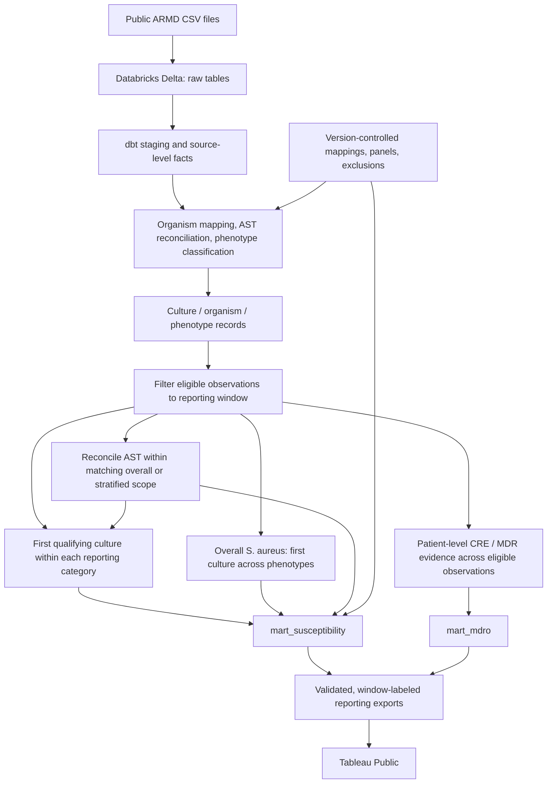
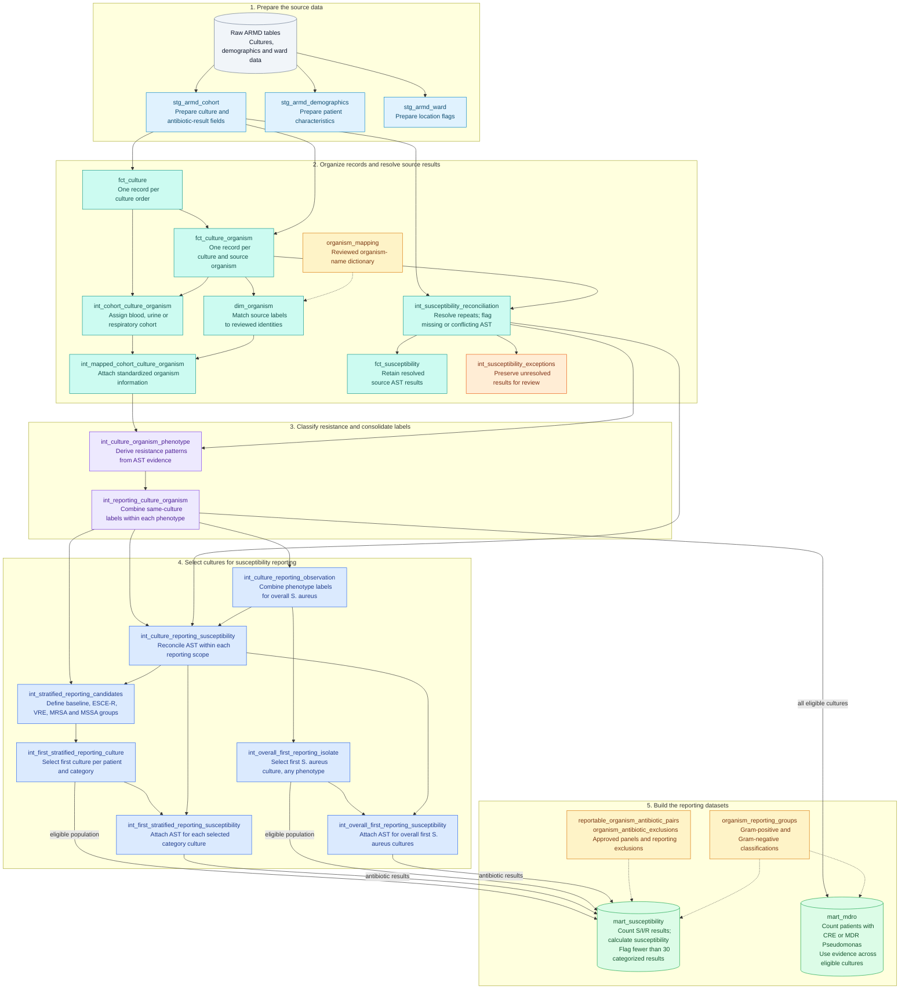

# Clinical Microbiology Analytics Lakehouse

**A reproducible antibiogram and antimicrobial resistance analytics portfolio project**  
**Databricks · Delta Lake · SQL · dbt · Python · Tableau Public**

[**Explore the interactive antibiogram on Tableau Public**](https://public.tableau.com/views/ARMDAntibiogram/BloodCultureGram-NegativeOrganisms?:language=en-US&publish=yes&:sid=&:redirect=auth&:display_count=n&:origin=viz_share_link)

## Project overview

As a quality management systems specialist / clinical data analyst working in clinical microbiology, I use laboratory information system data to monitor laboratory quality, analyze testing workflows, investigate antimicrobial resistance patterns, and produce cumulative antimicrobial susceptibility reports (*antibiograms*). This independent portfolio project demonstrates the intersection of **clinical microbiology, epidemiology, data engineering, analytics, and data visualization**.

The clinical data I work with professionally may contain **protected health information (PHI)** and cannot be published in a personal portfolio. Instead, this project uses the publicly available, de-identified **Antibiotic Resistance Microbiology Dataset (ARMD)** to demonstrate similar analytical methods and reporting decisions **without using data from my employer**.

I developed a version-controlled **extract, load, transform (ELT)** pipeline to convert source culture and antimicrobial susceptibility testing (AST) records into two validated reporting datasets: a specimen-stratified susceptibility mart and a multidrug-resistant organism (MDRO) mart. The susceptibility results are visualized as an interactive Tableau Public antibiogram.

> **Scope:** This is a retrospective research demonstration using source-reported AST categories. It is not an official institutional antibiogram, a fully CLSI M39-compliant implementation, or clinical decision support.

## Interactive Tableau antibiogram

**[Open the published Tableau Public workbook](https://public.tableau.com/views/ARMDAntibiogram/BloodCultureGram-NegativeOrganisms?:language=en-US&publish=yes&:sid=&:redirect=auth&:display_count=n&:origin=viz_share_link)**

The dashboard presents organism–antibiotic susceptibility summaries stratified by **blood, urine, and respiratory cultures**, with separate Gram-positive and Gram-negative views. The current reporting design separates ordinary (`base`) and resistance-phenotype populations, each selected independently. *Staphylococcus aureus* also has an overall population alongside separately selected MRSA and MSSA populations. Blank cells should not be interpreted as 0% susceptibility: a result may be omitted because a pair is not approved for reporting, is intentionally suppressed, or does not satisfy the minimum categorized-result threshold.

**How to interpret the tables:** `%S` is the percentage of **categorized S/I/R endpoints** that are classified as susceptible for a particular organism–antibiotic combination. Each reporting category has its own first-qualifying-culture population, distinct from the drug-specific categorized count. Patients can contribute to more than one category, so category counts are not additive unique-patient totals. Because ARMD lacks verified biological isolate identifiers, the analytical first-culture counts should not be construed as individually verified strains. See [Metric definitions](docs/metric_definitions.md) for denominators, exclusions, and limitations.

Reporting scope is recorded in the exported marts as `analysis_window_start` and `analysis_window_end_exclusive`. Retain these fields with each Tableau extract so the displayed results can be traced to the reporting period used to build them.

### Tableau connection and publication approach

For this portfolio demonstration, the validated reporting marts are **exported from Databricks** for use in Tableau Public. Tableau workbook and extract files are intentionally not tracked in this GitHub repository; the published interactive workbook is available through the link above.

In a typical internal clinical analytics environment, I would **connect Tableau directly to the curated Databricks data source**, rather than manually maintaining exported CSVs. That allows visualizations to consume centrally maintained tables, with refreshes coordinated through the data pipeline and supported Tableau connection/refresh capabilities. Such a deployment would also require institutional access controls and PHI governance; Tableau Public is not appropriate for protected clinical data.

## Public data source

**[Antibiotic Resistance Microbiology Dataset (ARMD)](https://doi.org/10.5061/dryad.jq2bvq8kp)** — Nateghi Haredasht and colleagues; **April 11, 2025 release**.

| Source file | Role in the project |
|---|---|
| `microbiology_cultures_cohort.csv` | Culture orders, organism observations, and source-reported AST |
| `microbiology_cultures_demographics.csv` | Supporting demographic and encounter information |
| `microbiology_cultures_ward_info.csv` | Supporting ward and location information |

The current analytical cohorts are **blood, urine, and respiratory** cultures. The source uses shifted, de-identified culture timestamps, which support within-dataset ordering but should not be interpreted as actual clinical calendar dates. **The ARMD release date is not the period covered by a clinical annual antibiogram.**

## Data pipeline architecture



### Why combine Databricks, dbt, and Tableau?

Each tool handles a different part of the analytics lifecycle, allowing data preparation, reporting logic, and visualization to evolve independently.

| Technology | Responsibility | Advantage for clinical laboratory analytics |
|---|---|---|
| **Databricks + Delta Lake** | Load, store, and query raw and curated data in a centralized lakehouse | Provides a scalable SQL environment for large, repeatedly processed LIS/EHR extracts; curated tables can be reused across reports rather than rebuilt inside individual dashboards. |
| **dbt** | Organize SQL transformations into dependency-aware models, with seeds, documentation, and automated tests | Makes specimen definitions, organism terminology, AST reconciliation, and reporting exclusions **explicit, version-controlled, testable, and repeatable**. A changed rule can be reviewed and validated before downstream reports are refreshed. |
| **Tableau** | Present validated metrics through interactive worksheets and dashboards | Lets microbiology, quality, and antimicrobial stewardship teams explore susceptibility and resistance patterns without reproducing complex transformation logic in each workbook. |
| **Python + SQL validation notebooks** | Explore source structure, investigate ambiguous records, and independently verify model outputs | Supports reproducible investigation of data-quality issues and documents why modeling and microbiology reporting decisions were made. |

**The main architectural advantage is separation of responsibilities:** Databricks manages the analytical data; dbt produces tested, reusable reporting definitions; Tableau visualizes those trusted outputs. This minimizes manual spreadsheet work, reduces duplicated dashboard calculations, and makes it easier to maintain consistent results across multiple stakeholders and reporting products.

## Key analytical and modeling decisions

1. **Preserve source grain and provenance.** Culture orders, source culture–organism observations, and organism–antibiotic endpoints are separate. Reviewed mappings retain the original labels and qualifiers.
2. **Keep ambiguous AST visible.** Reconciliation retains missing and conflicting endpoints. The shared reporting reconciliation uses all source labels for overall *S. aureus*, and only labels within the selected phenotype category for stratified results.
3. **Filter the period before selecting cultures.** The optional 12-month window limits eligible observations before patient-level ranking and MDRO aggregation. 
4. **Select each phenotype population independently.** Ordinary (`base`), ESCE-R, VRE, MRSA, and MSSA categories select their first qualifying culture per patient/cohort/organism/category. One patient can enter multiple categories. `base` is a reporting category, not proof of wild-type susceptibility. Overall *S. aureus* separately uses its first culture regardless of phenotype.
5. **Keep MDRO evidence separate.** CRE and MDR *Pseudomonas aeruginosa* reporting records do not enter the main susceptibility categories. `mart_mdro` summarizes their patient-level evidence across eligible observations in the same window, with positive evidence taking precedence over not-evaluable and not-detected evidence.
6. **Apply explicit reporting controls.** Reviewed cohort-specific organism–antibiotic approvals and cohort/category-scoped exclusions determine the panel. A `*` scope applies a rule to all cohorts or categories. At least 30 categorized S/I/R results are required to designate a susceptibility percentage for display.

### Validated reporting datasets

| dbt mart | Analytical grain and purpose |
|---|---|
| `mart_susceptibility` | Source release × specimen cohort × organism reporting group × reporting category × approved antibiotic, within the configured window. Reports category-specific eligible and categorized counts, S/I/R counts, `% susceptible`, testing coverage, and display status. Percentages are designated for display when at least **30 categorized results** are available. |
| `mart_mdro` | Source release × specimen cohort × base organism × MDRO phenotype, within the configured window. Summarizes patient-level CRE and MDR *P. aeruginosa* evidence, including positive, not-detected, and not-evaluable counts, phenotype proportion, and evaluability. |

The pipeline uses susceptibility categories **as supplied by ARMD**; it does not reconstruct MIC values or reinterpret results under contemporary breakpoints. Detailed formulas, phenotype definitions, and clinical limitations are in [Metric definitions](docs/metric_definitions.md).

### How the MDRO mart is built

`mart_mdro` answers: **How many eligible patients had evidence of CRE or multidrug-resistant *Pseudomonas aeruginosa* during the reporting period?** It evaluates **all eligible culture observations**, rather than selecting only each patient's first culture.

Resistance statuses are derived upstream in `int_culture_organism_phenotype` from reconciled AST results. Original organism-name qualifiers remain traceable, but do not establish resistance on their own.

| MDRO phenotype | Project rule for positive evidence |
|---|---|
| **CRE** — carbapenem-resistant Enterobacterales | A resolved `Resistant` result to a qualifying carbapenem in a reviewed eligible organism, with documented organism-specific exceptions. |
| **MDR *P. aeruginosa*** | Resolved `Intermediate` or `Resistant` results in at least **three of six reviewed antimicrobial categories**. Incomplete testing remains not evaluable when the unknown categories could change the classification. |

After source labels are consolidated in `int_reporting_culture_organism`, the mart:

1. **Filters the population.** Apply the configured reporting window and exclude observations where the specific phenotype is `not_applicable`.
2. **Assigns one patient-level status.** Group by source release, specimen cohort, patient, and base organism. Any positive observation makes the patient group `positive`; otherwise, any `not_evaluable` observation takes precedence over `not_detected`.
3. **Summarizes the patient groups.** Count positive, not-detected, and not-evaluable groups for each source release × cohort × base organism × MDRO phenotype. Repeated cultures do not count the same patient twice within that analysis.
4. **Adds reporting fields.** Calculate phenotype and evaluability percentages, retain the reporting-window dates, and join Gram classification from `organism_reporting_groups`.

| Output | Calculation |
|---|---|
| `denominator_count` | `positive_count + not_detected_count + not_evaluable_count` |
| `phenotype_pct` | `100 × positive_count / denominator_count` |
| `evaluable_pct` | `100 × (positive_count + not_detected_count) / denominator_count` |

**Not-evaluable patient groups remain in the denominator and are not classified as negative.** The phenotype percentage therefore describes all eligible patient–organism groups, rather than only those with determinate AST evidence. A patient can contribute to different cohorts or organisms, so these counts are not additive unique-patient totals. Full drug definitions and exceptions are in [Metric definitions](docs/metric_definitions.md).


## How this architecture could support routine clinical reporting

This repository implements a **fixed-release retrospective batch pipeline with an optional 12-month shifted-date research window**. It does not implement live LIS/EHR ingestion or scheduled longitudinal surveillance. With governed clinical data, real event timestamps, and scheduled ingestion/builds, the same architecture could be extended to support:

- **Annual cumulative antibiograms:** select a defined annual cohort, reapply the first-eligible-isolate policy *within that reporting year*, validate organism–antibiotic denominators, and publish consistent tables for clinical microbiology and antimicrobial stewardship programs.
- **Periodically updated or rolling antibiograms:** ingest new eligible cultures on a schedule and **recalculate the first-isolate population within each rolling reporting window** (for example, the preceding 12 months). A rolling report cannot be produced correctly by simply filtering a mart that selected each patient's first culture across the entire dataset.
- **Resistance-pattern monitoring:** construct time-indexed, source-governed reporting marts to examine longitudinal susceptibility patterns, selected resistance phenotypes, test coverage, and changes in MDRO classifications. Trend interpretation would require stable methods, comparable reporting periods, and attention to changes in AST testing/breakpoints.
- **Reusable quality and stewardship dashboards:** feed several Tableau dashboards from the same tested transformations, with refreshes and reporting rules managed centrally instead of by manual workbook updates.

The current project demonstrates window filtering, within-window selection, and reporting validation. Clinical annual reporting, scheduled refreshes, and longitudinal surveillance would require the additional data and governance described above.


## Repository guide

| Path | What it contains |
|---|---|
| `dbt/models/staging/` | ARMD staging and existing culture/AST core models |
| `dbt/models/intermediate/` | AST reconciliation, mapping, phenotype evaluation, and reporting-population logic |
| `dbt/models/marts/` | Final susceptibility and MDRO marts |
| `dbt/seeds/` | Reviewed organism mappings, Gram groups, antibiotic approvals, and exclusions |
| `dbt/tests/` | Custom data-quality and reporting-policy assertions |
| `notebooks/source_exploration/` | Source profiling and initial grain assessment |
| `notebooks/pipeline validation/` | Source profiling and validation history; notebooks 13–14 document the current reporting design and window |
| `dbt/macros/analysis_window.sql` | Inclusive start / exclusive 12-month end and window metadata |
| `docs/metric_definitions.md` | Detailed metric definitions, methodology, and limitations |
| [`docs/`](docs/) | Additional project materials, including a **PDF** and a **PowerPoint presentation (`.pptx`)** |
| `data/exports/` | Reporting extracts produced from the validated marts, when published |

### Data transformations

<details>
<summary>Show the complete model-by-model transformation diagram</summary>

The dbt pipeline turns raw culture records into two reporting datasets. Each box names a model and summarizes its transformation. AST means antimicrobial susceptibility testing; MDRO means multidrug-resistant organism. Dashed arrows show reference-data lookups.



- **Susceptibility reporting:** baseline and resistance categories select their first qualifying cultures independently. S. aureus also has an overall first-culture population. CRE and MDR Pseudomonas categories are reserved for the separate MDRO summary. A patient may appear in multiple categories; baseline does not guarantee susceptibility.
- **Reporting period:** when configured, the research date window is applied before first-culture selection and to the MDRO population. Demographics and ward models support additional analyses and do not currently feed these two marts.

</details>


## Reproducing the pipeline

This is a Databricks-based batch ELT project for the **2025-04-11 ARMD source release**. The repository does not currently package a one-command, from-scratch warehouse ingestion workflow.

1. Download the three CSVs from the [public ARMD release](https://doi.org/10.5061/dryad.jq2bvq8kp) and load them into Databricks raw Delta tables matching the declared dbt sources (`workspace.micro_raw` in this development environment).
2. Install dbt Core and the Databricks adapter; configure a Databricks SQL warehouse and a private dbt profile (`~/.dbt/profiles.yml`). Do not commit secrets, tokens, or employer data.
3. Select the reporting period in `dbt/dbt_project.yml`. The current configuration is:

   ```yaml
   vars:
     analysis_window_start: '2023-01-01'
   ```

   The end is computed as 12 months after the start and is exclusive. Remove the variable or set it to `null` for a full-release comparison. Preserve existing exports before rebuilding a different scope: the current mart tables are replaced, and the surrogate keys do not encode the window.

4. From the `dbt/` directory, run:

   ```powershell
   dbt deps
   dbt debug
   dbt build
   ```

5. Rerun relevant notebooks in `notebooks/pipeline validation/` in a VS Code notebook environment with a working Databricks connection. Notebook `%sql` cells query Databricks tables directly and do not use dbt's `{{ ref(...) }}` syntax.
6. Verify the mart window columns and display coverage in Notebook 13, then export the **current** validated datasets for Tableau Public publication. Include the reporting-window fields and preserve full-release and annual outputs separately. In a governed internal implementation, Tableau could instead query the Databricks marts directly.

## Skills demonstrated

**Clinical microbiology analytics · ELT pipeline design · Databricks and Delta Lake · SQL data modeling · dbt transformations and testing · Python exploratory analysis · terminology mapping · AST and resistance phenotype interpretation · data-quality validation · Tableau dashboard design**

### AI assistance

ChatGPT (OpenAI) assisted with SQL and dbt development, troubleshooting, validation queries, and documentation. I reviewed and refined the implementation using my clinical microbiology expertise and validated the pipeline with dbt tests and SQL notebooks. I remain responsible for the final code, reporting decisions, and interpretation.

## Data use, interpretation, and citation

The source is a de-identified retrospective research extract without verified biological isolate identifiers. Antibiotic testing is selective, and results may be missing or conflicting. Shifted timestamps and project-specific organism/panel policies restrict interpretation. The displayed summaries represent **source-reported AST under the stated research rules** and should not be used for patient care or assumed to represent institutional resistance prevalence.

**Source citation:** Nateghi Haredasht F, Amrollahi F, Maddali M, et al. (2025). *Antibiotic Resistance Microbiology Dataset (ARMD): A resource for antimicrobial resistance from EHRs*. Dryad. [doi:10.5061/dryad.jq2bvq8kp](https://doi.org/10.5061/dryad.jq2bvq8kp).
