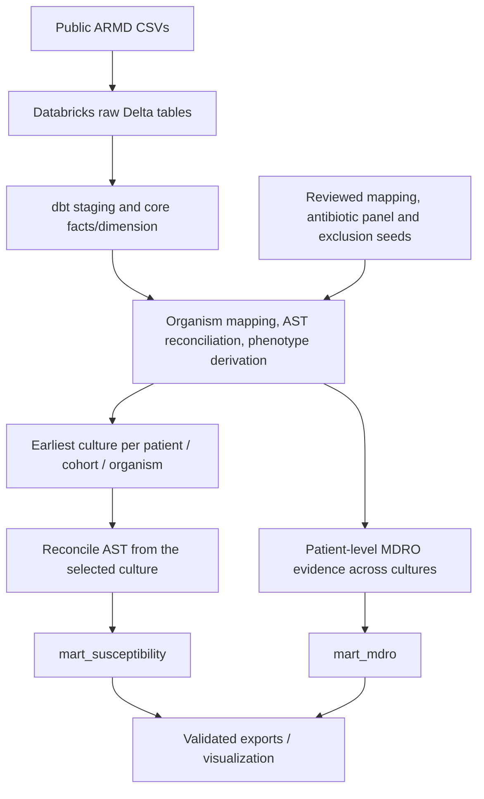

# Clinical Microbiology Analytics Lakehouse

**A public-data antibiogram and antimicrobial resistance analytics portfolio project**  
*Databricks · SQL · dbt · Python · Tableau-ready reporting*

## Overview

In my work in clinical microbiology, I use laboratory information system data to monitor quality, evaluate laboratory workflows, and produce cumulative antimicrobial susceptibility reports (antibiograms). This project showcases the intersection of **clinical laboratory expertise, data engineering, and analytics** using a reproducible, version-controlled ELT pipeline.

Because the clinical data I work with professionally can contain **protected health information (PHI)**, I created this independent example using the publicly available, de-identified **Antibiotic Resistance Microbiology Dataset (ARMD)**. It demonstrates the types of data cleaning, microbiology reporting decisions, quality checks, and analytical outputs involved in my work **without using patient data from my employer**.

The pipeline transforms raw culture and antimicrobial susceptibility testing (AST) data into two reporting-ready datasets: a **specimen-stratified susceptibility summary** and a **multidrug-resistant organism (MDRO) summary**.

> **Scope:** This is a retrospective research and portfolio analysis—not an official clinical antibiogram, a fully CLSI M39-compliant implementation, or clinical decision support.

## Public data source

**[Antibiotic Resistance Microbiology Dataset (ARMD)](https://doi.org/10.5061/dryad.jq2bvq8kp)** — Nateghi Haredasht and colleagues; **April 11, 2025 release**.

| Input file | Purpose |
|---|---|
| `microbiology_cultures_cohort.csv` | Culture records, organism observations, and source-reported AST |
| `microbiology_cultures_demographics.csv` | Supporting demographic and encounter information |
| `microbiology_cultures_ward_info.csv` | Supporting location/ward information |

The current analysis covers **blood, urine, and respiratory** culture cohorts. De-identified culture timestamps are shifted; they are used for relative ordering, not as actual calendar dates. The source release is not treated as a single calendar-year antibiogram.

## Data pipeline



### Key modeling decisions

1. **Preserve the source grain.** Culture orders, culture-organism observations, and antibiotic endpoints are modeled separately so long-format AST records do not inflate culture counts.
2. **Make terminology and reporting policies reviewable.** dbt seeds maintain organism mappings, Gram classifications, cohort-specific antibiotic approvals, and explicit reporting exclusions. Original organism names and source qualifiers remain traceable.
3. **Reconcile ambiguous AST.** Repeated or combined source records are checked for missing and conflicting susceptibility interpretations; the pipeline does not arbitrarily choose the latest or most resistant value.
4. **Select the overall first culture before looking at antibiotics.** For the susceptibility analysis, the earliest eligible culture is selected per patient, specimen cohort, and reporting organism **regardless of resistance phenotype or drug availability**. AST from multiple source labels on that culture is reconciled together. This prevents resistant observations from disappearing from the overall population.
5. **Keep MDRO measurement distinct.** CRE and MDR *Pseudomonas aeruginosa* summaries evaluate patient-level phenotype evidence **across eligible cultures**, using a different denominator from the first-culture susceptibility analysis. Phenotype status distinguishes positive, not detected, not evaluable, and not applicable.

### Reporting outputs

| dbt mart | Output |
|---|---|
| `mart_susceptibility` | One row per source release × specimen cohort × reporting organism × reporting subgroup × reviewed antibiotic. Includes **`overall`** and selected AST-supported resistance subgroups, counts of eligible and tested cultures, categorized S/I/R results, `% susceptible`, and testing coverage. A minimum of **30 categorized results** is required for display. |
| `mart_mdro` | One row per source release × cohort × base organism × MDRO phenotype. Reports CRE and MDR *P. aeruginosa*, including positive, not-detected, and not-evaluable patient counts and phenotype/evaluability percentages. |

The source AST interpretations are **not reclassified using reconstructed MICs or new breakpoints**. Reporting-panel rules and phenotype definitions are documented in **[Metric definitions](docs/metric_definitions.md)**.

## Validation

The pipeline combines **dbt data tests** (uniqueness, relationships, accepted values, count identities, approved-pair completeness, and subgroup/overall denominators) with **independent SQL validation notebooks** documenting source profiling, terminology decisions, first-culture selection, phenotype evaluation, and mart reconciliation.

**Latest completed full dbt build:** 17 models, 4 seeds, **184 passing data tests**, zero warnings and zero errors (205 successful operations). Notebook validation is maintained separately and should be rerun after changes affecting its queries.

## Repository structure

| Path | Contents |
|---|---|
| `dbt/models/staging/` | ARMD staging and culture/AST core models |
| `dbt/models/intermediate/` | Reconciliation, mapping, phenotype, and reporting-population SQL |
| `dbt/models/marts/` | Final susceptibility and MDRO marts |
| `dbt/seeds/` | Versioned mapping, reporting-group, approval, and exclusion reference tables |
| `dbt/tests/` | Custom data-quality and reporting-policy assertions |
| `notebooks/source_exploration/` | Initial exploration and grain assessment |
| `notebooks/pipeline validation/` | Numbered executable SQL validation notebooks |
| `docs/metric_definitions.md` | Definitions, methods, formulas, and interpretation limitations |
| `data/exports/` | Regenerated reporting extracts, when exported |

## Running the pipeline

This is a **batch ELT workflow for a fixed public dataset release**, not a live clinical feed.

1. Download the three CSVs from the **April 11, 2025** ARMD release. Load them into Databricks Delta tables matching the project's declared dbt sources (`workspace.micro_raw` in the development environment). **Raw ingestion and workspace setup are prerequisites**; a one-command, from-scratch loader is not yet packaged here.
2. Set up Python, dbt Core, and the Databricks adapter. Configure your own warehouse credentials in `~/.dbt/profiles.yml`; private connection files are not version-controlled.
3. From the `dbt/` directory, with the environment activated, run:

   ```powershell
   dbt deps
   dbt debug
   dbt build
   ```

4. Run the numbered notebooks in `notebooks/pipeline validation/` using a VS Code kernel connected to Databricks. Their `%sql` cells query workspace tables directly; unlike dbt models, they do not use `{{ ref(...) }}`.
5. Export the **current validated** marts before using them for external reporting. Tableau workbook files are intentionally excluded from Git; a Tableau Public dashboard can be linked here when available.

## Skills demonstrated

**SQL and dimensional modeling · Databricks/Delta Lake · dbt ELT and automated testing · Python exploration · clinical data validation · terminology normalization · AST and resistance phenotype analysis · reproducible reporting policies**

## Interpretation limitations and attribution

ARMD is a de-identified retrospective extract without verified biological isolate IDs. Selective antimicrobial testing, missing/conflicting interpretations, shifted dates, and project-specific organism/panel decisions constrain interpretation. These are **research summaries of source-reported AST**, not recommendations for clinical treatment.

**Dataset citation:** Nateghi Haredasht F, Amrollahi F, Maddali M, et al. (2025). *Antibiotic Resistance Microbiology Dataset (ARMD): A resource for antimicrobial resistance from EHRs*. Dryad. [doi:10.5061/dryad.jq2bvq8kp](https://doi.org/10.5061/dryad.jq2bvq8kp).
