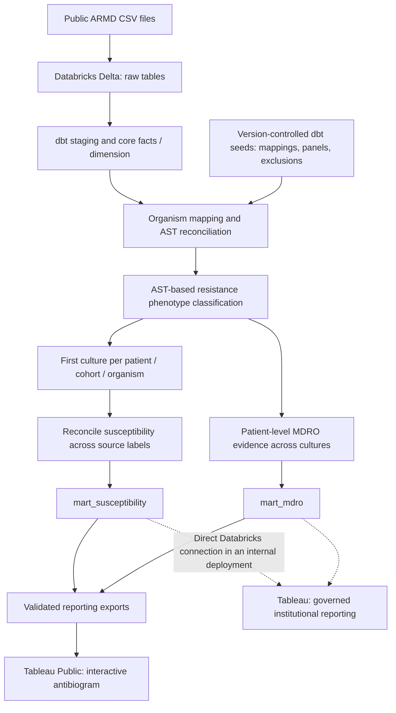

# Clinical Microbiology Analytics Lakehouse

**A reproducible antibiogram and antimicrobial resistance analytics portfolio project**  
**Databricks · Delta Lake · SQL · dbt · Python · Tableau Public**

[**Explore the interactive antibiogram on Tableau Public**](https://public.tableau.com/views/ARMDAntibiogram/RespiratoryGramPositive)

## Project overview

As a quality management systems specialist / clinical data analyst working in clinical microbiology, I use laboratory information system data to monitor laboratory quality, analyze testing workflows, investigate antimicrobial resistance patterns, and produce cumulative antimicrobial susceptibility reports (*antibiograms*). This independent portfolio project demonstrates the intersection of **clinical microbiology, epidemiology, data engineering, analytics, and data visualization**.

The clinical data I work with professionally may contain **protected health information (PHI)** and cannot be published in a personal portfolio. Instead, this project uses the publicly available, de-identified **Antibiotic Resistance Microbiology Dataset (ARMD)** to demonstrate similar analytical methods and reporting decisions **without using data from my employer**.

I developed a version-controlled **extract, load, transform (ELT)** pipeline to convert source culture and antimicrobial susceptibility testing (AST) records into two validated reporting datasets: a specimen-stratified susceptibility mart and a multidrug-resistant organism (MDRO) mart. The susceptibility results are visualized as an interactive Tableau Public antibiogram.

> **Scope:** This is a retrospective research demonstration using source-reported AST categories. It is not an official institutional antibiogram, a fully CLSI M39-compliant implementation, or clinical decision support.

## Interactive Tableau antibiogram

**[Open the published Tableau Public workbook](https://public.tableau.com/views/ARMDAntibiogram/RespiratoryGramPositive)**

The dashboard presents organism–antibiotic susceptibility summaries stratified by **blood, urine, and respiratory cultures**, with separate Gram-positive and Gram-negative views. The tables distinguish overall organism populations from selected resistance-phenotype subgroups. Blank cells should not be interpreted as 0% susceptibility: a result may be omitted because a pair is not approved for reporting, is intentionally suppressed, or does not satisfy the minimum categorized-result threshold.

**How to interpret the tables:** `%S` is the percentage of **categorized S/I/R endpoints** that are classified as susceptible for a particular organism–antibiotic combination. The overall first-culture population is a different denominator from the drug-specific categorized count. Because ARMD lacks verified biological isolate identifiers, the analytical first-culture counts should not be construed as individually verified strains. See [Metric definitions](docs/metric_definitions.md) for denominators, exclusions, and limitations.

### Tableau connection and publication approach

For this portfolio demonstration, the validated reporting marts are **exported from Databricks** for use in Tableau Public. Tableau workbook and extract files are intentionally not tracked in this GitHub repository; the published interactive workbook is available through the link above.

In a typical internal clinical analytics environment, I would **connect Tableau directly to the curated Databricks data source**, rather than manually maintaining exported CSVs. That allows visualizations to consume centrally maintained tables, with refreshes coordinated through the data pipeline and supported Tableau connection/refresh capabilities. Such a deployment would also require institutional access controls and PHI governance; Tableau Public is not appropriate for protected clinical data.

## Public data source

**[Antibiotic Resistance Microbiology Dataset (ARMD)](https://doi.org/10.5061/dryad.jq2bvq8kp)** — Nateghi Haredasht and colleagues; **April 11, 2025 release**.

| Source file | Role in the project |
|---|---|
| `microbiology_cultures_cohort.csv` | Culture orders, organism observations, and source-reported AST |
| `microbiology_cultures_demographics.csv` | Supporting demographic and encounter information |
| `microbiology_cultures_ward_info.csv` | Supporting ward and location information |

The current analytical cohorts are **blood, urine, and respiratory** cultures. The source uses shifted, de-identified culture timestamps, which support within-dataset ordering but should not be interpreted as actual clinical calendar dates. **The ARMD release date is not the period covered by a clinical annual antibiogram.**

## Data pipeline architecture



### Why combine Databricks, dbt, and Tableau?

Each tool handles a different part of the analytics lifecycle, allowing data preparation, reporting logic, and visualization to evolve independently.

| Technology | Responsibility | Advantage for clinical laboratory analytics |
|---|---|---|
| **Databricks + Delta Lake** | Load, store, and query raw and curated data in a centralized lakehouse | Provides a scalable SQL environment for large, repeatedly processed LIS/EHR extracts; curated tables can be reused across reports rather than rebuilt inside individual dashboards. |
| **dbt** | Organize SQL transformations into dependency-aware models, with seeds, documentation, and automated tests | Makes specimen definitions, organism terminology, AST reconciliation, and reporting exclusions **explicit, version-controlled, testable, and repeatable**. A changed rule can be reviewed and validated before downstream reports are refreshed. |
| **Tableau** | Present validated metrics through interactive worksheets and dashboards | Lets microbiology, quality, and antimicrobial stewardship teams explore susceptibility and resistance patterns without reproducing complex transformation logic in each workbook. |
| **Python + SQL validation notebooks** | Explore source structure, investigate ambiguous records, and independently verify model outputs | Supports reproducible investigation of data-quality issues and documents why modeling and microbiology reporting decisions were made. |

**The main architectural advantage is separation of responsibilities:** Databricks manages the analytical data; dbt produces tested, reusable reporting definitions; Tableau visualizes those trusted outputs. This minimizes manual spreadsheet work, reduces duplicated dashboard calculations, and makes it easier to maintain consistent results across multiple stakeholders and reporting products.

## Key analytical and modeling decisions

1. **Preserve the grain of the source data.** Culture orders, culture–organism observations, and organism–antibiotic results are modeled separately so the long-format AST records do not inflate culture counts.
2. **Standardize terminology without losing provenance.** Version-controlled dbt seeds define reviewed organism mappings, Gram groupings, cohort-specific antibiotic panels, and explicit exclusions, while source organism labels and qualifiers remain traceable.
3. **Reconcile conflicting and missing AST interpretations.** Repeated source endpoints and combined labels are evaluated rather than arbitrarily choosing the newest or most resistant result. Unresolved results remain visible as quality metrics.
4. **Select the overall first culture before evaluating antibiotic results.** The susceptibility population selects the earliest eligible culture per patient, specimen cohort, and reporting organism, **regardless of resistance phenotype or antibiotic availability**. Results from qualifying source labels on that culture are reconciled together. This avoids excluding resistant observations from the overall organism population.
5. **Keep resistance subgroups and MDRO surveillance separate.** Selected phenotype-specific susceptibility subgroups are derived from the overall first-culture population. The MDRO mart instead summarizes CRE and MDR *Pseudomonas aeruginosa* phenotype evidence **across eligible culture observations** at a distinct patient-level grain.

### Validated reporting datasets

| dbt mart | Analytical grain and purpose |
|---|---|
| `mart_susceptibility` | Source release × specimen cohort × organism reporting group × susceptibility subgroup × approved antibiotic. Reports eligible and categorized counts, S/I/R counts, `% susceptible`, testing coverage, and display status. Contains overall organism rows plus selected phenotype subgroups. Percentages are designated for display when at least **30 categorized results** are available. |
| `mart_mdro` | Source release × specimen cohort × base organism × MDRO phenotype. Summarizes patient-level CRE and MDR *P. aeruginosa* evidence, including positive, not-detected, and not-evaluable counts, phenotype proportion, and evaluability. |

The pipeline uses susceptibility categories **as supplied by ARMD**; it does not reconstruct MIC values or reinterpret results under contemporary breakpoints. Detailed formulas, phenotype definitions, and clinical limitations are in [Metric definitions](docs/metric_definitions.md).

## How this architecture could support routine clinical reporting

This repository demonstrates a **fixed-release retrospective batch pipeline**, not a live LIS/EHR integration or an already implemented longitudinal surveillance system. With governed clinical data, real event timestamps, and scheduled ingestion/builds, the same architecture could be extended to support:

- **Annual cumulative antibiograms:** select a defined annual cohort, reapply the first-eligible-isolate policy *within that reporting year*, validate organism–antibiotic denominators, and publish consistent tables for clinical microbiology and antimicrobial stewardship programs.
- **Periodically updated or rolling antibiograms:** ingest new eligible cultures on a schedule and **recalculate the first-isolate population within each rolling reporting window** (for example, the preceding 12 months). A rolling report cannot be produced correctly by simply filtering a mart that selected each patient's first culture across the entire dataset.
- **Resistance-pattern monitoring:** construct time-indexed, source-governed reporting marts to examine longitudinal susceptibility patterns, selected resistance phenotypes, test coverage, and changes in MDRO classifications. Trend interpretation would require stable methods, comparable reporting periods, and attention to changes in AST testing/breakpoints.
- **Reusable quality and stewardship dashboards:** feed several Tableau dashboards from the same tested transformations, with refreshes and reporting rules managed centrally instead of by manual workbook updates.

These are **potential production extensions**, not capabilities claimed for the shifted-date public ARMD extract as currently modeled.

## Validation and quality assurance

Automated **dbt data tests** cover uniqueness, relationships, accepted values, count identities, approved organism–antibiotic pair completeness, and phenotype-subgroup denominators. Numbered SQL notebooks provide independent checks of source grains, AST reconciliation, organism mapping, phenotype derivation, first-culture selection, and both final marts.

**Most recent completed full dbt regression build:** **17 models, 4 reference seeds, 184 passing data tests, zero warnings, zero errors** (**205 successful operations**). The validation notebooks are supplementary and should be rerun after meaningful upstream changes.

## Repository guide

| Path | What it contains |
|---|---|
| `dbt/models/staging/` | ARMD staging and existing culture/AST core models |
| `dbt/models/intermediate/` | AST reconciliation, mapping, phenotype evaluation, and reporting-population logic |
| `dbt/models/marts/` | Final susceptibility and MDRO marts |
| `dbt/seeds/` | Reviewed organism mappings, Gram groups, antibiotic approvals, and exclusions |
| `dbt/tests/` | Custom data-quality and reporting-policy assertions |
| `notebooks/source_exploration/` | Source profiling and initial grain assessment |
| `notebooks/pipeline validation/` | Numbered SQL-based pipeline validation notebooks |
| `docs/metric_definitions.md` | Detailed metric definitions, methodology, and limitations |
| [`docs/`](docs/) | Additional project materials, including a **PDF** and a **PowerPoint presentation (`.pptx`)** |
| `data/exports/` | Reporting extracts produced from the validated marts, when published |

## Reproducing the pipeline

This is a Databricks-based batch ELT project for the **2025-04-11 ARMD source release**. The repository does not currently package a one-command, from-scratch warehouse ingestion workflow.

1. Download the three CSVs from the [public ARMD release](https://doi.org/10.5061/dryad.jq2bvq8kp) and load them into Databricks raw Delta tables matching the declared dbt sources (`workspace.micro_raw` in this development environment).
2. Install dbt Core and the Databricks adapter; configure a Databricks SQL warehouse and a private dbt profile (`~/.dbt/profiles.yml`). Do not commit secrets, tokens, or employer data.
3. From the `dbt/` directory, run:

   ```powershell
   dbt deps
   dbt debug
   dbt build
   ```

4. Rerun relevant notebooks in `notebooks/pipeline validation/` in a VS Code notebook environment with a working Databricks connection. Notebook `%sql` cells query Databricks tables directly and do not use dbt's `{{ ref(...) }}` syntax.
5. Verify the mart outputs, then export the **current** validated datasets used for Tableau Public publication. In a governed internal implementation, Tableau could instead query the Databricks marts directly.

## Skills demonstrated

**Clinical microbiology analytics · ELT pipeline design · Databricks and Delta Lake · SQL data modeling · dbt transformations and testing · Python exploratory analysis · terminology mapping · AST and resistance phenotype interpretation · data-quality validation · Tableau dashboard design**

## Data use, interpretation, and citation

The source is a de-identified retrospective research extract without verified biological isolate identifiers. Antibiotic testing is selective, and results may be missing or conflicting. Shifted timestamps and project-specific organism/panel policies restrict interpretation. The displayed summaries represent **source-reported AST under the stated research rules** and should not be used for patient care or assumed to represent institutional resistance prevalence.

**Source citation:** Nateghi Haredasht F, Amrollahi F, Maddali M, et al. (2025). *Antibiotic Resistance Microbiology Dataset (ARMD): A resource for antimicrobial resistance from EHRs*. Dryad. [doi:10.5061/dryad.jq2bvq8kp](https://doi.org/10.5061/dryad.jq2bvq8kp).
